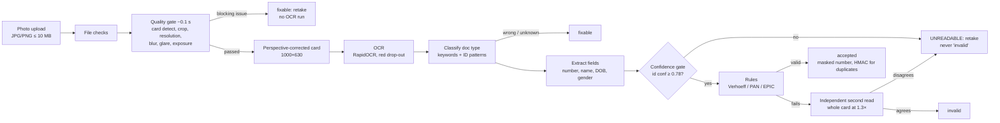

# Engine and Evaluation

## Engine

The engine checks a photo of an ID card (Aadhaar front/back, PAN, Voter ID) in about a second and
explains every rejection with the measured value and its threshold.



**Design rules we hold to**
- **Quality first, OCR second.** A blurry photo is rejected in about 0.1 s without running OCR.
- **"Can't read" is never "invalid".** Checksum and format rules only run when the ID-number OCR
  confidence clears the gate. A failing number is only called `invalid` when a second, independent
  read of the card agrees. Otherwise the citizen is asked to retake.
- **Name matching has three tiers.** Tamil Nadu initials (`R. KARTHIK` ↔ `KARTHIK RAJENDRAN`) are at
  most `likely_match`, an officer confirms, and the date of birth breaks ties. Matching ignores spaces,
  because OCR often drops them; spaces are restored for display using the father's name printed on PAN
  and Voter ID cards.
- **Aadhaar privacy.** The full number is never returned, logged or stored: the display is
  `XXXX XXXX 1234`, and duplicates are found with `HMAC-SHA256(server secret, number)`. A plain hash
  would be brute-forceable (only 10¹² numbers). Card images are Fernet-encrypted at rest and deleted
  when an officer decides.
- **Explainable.** Every issue carries `evidence` (e.g. `{"blur_score": 41.2, "threshold": 140}`),
  and every threshold lives in `engine/app/validation/thresholds.json`.

**Why no deep model?** Deterministic checks are explainable, fast on a CPU, and need no labelled
real-world training data. Any single check can later be replaced by a model behind the same interface.

**Duplicates.** The same Aadhaar (by HMAC) in another application raises `DUPLICATE_SUSPECTED` for the
officer only. Perceptual-hash matching of card photos was evaluated and **switched off**: different
citizens' cards of the same type can have identical perceptual hashes, which would flag innocent people.

## Synthetic data

No real ID images are used anywhere. `engine/datagen` renders SPECIMEN cards (text-only headers, no
emblems or logos, a diagonal `SPECIMEN — NOT A REAL DOCUMENT` watermark) for fake Coimbatore-area
citizens, then simulates a phone photo: background, perspective, rotation, shadow, lighting gradient,
sensor noise and JPEG compression. Error injectors add blur, glare, under- and over-exposure, cropping,
low resolution, the wrong document type and invalid Aadhaar checksums, each with its true label.

| Split | Images | Backgrounds | Used for |
|---|---|---|---|
| tune | 300 | set A (wood, fabric, granite) | choosing thresholds |
| test | 300 | set B (desk, paper, tiles) | the numbers below, and nothing else |
| sets | 34 + 34 | A / B | name-consistency tuning / testing |

## Threshold tuning (`python -m evaluation.tune`, tune split only)

- **Quality checks:** grid search per check, maximising F1 for its code with **at most 5% false
  retakes** on images that have no quality problem (telling a genuine citizen to retake is a cost).
  When several values tie, we take the middle of the tied range for the most margin.
- **OCR confidence gate:** the value that **minimises false invalids** while keeping
  `INVALID_CHECKSUM` recall ≥ 0.9. Among ties we take the most conservative gate that adds at most two
  points of retakes.
- **Name thresholds:** chosen on the tune document sets.
- Measurements and OCR reads are cached, so the search runs on numbers and never re-runs OCR.

## Evaluation (`python -m evaluation.run`, held-out test split only)

Source: `engine/evaluation/results.json` (also served at `/api/metrics/detection`); details and the worst
failures are in `engine/evaluation/report.md`.

**False-invalid rate: 0.0%.** No genuine card was marked `invalid`. This is the key trust metric.

| Code | Precision | Recall | F1 | Support |
|---|---|---|---|---|
| CROPPED | 1.00 | 1.00 | 1.00 | 35 |
| BLUR | 0.88 | 0.81 | 0.85 | 27 |
| GLARE | 1.00 | 1.00 | 1.00 | 33 |
| TOO_DARK | 1.00 | 1.00 | 1.00 | 27 |
| TOO_BRIGHT | 1.00 | 0.85 | 0.92 | 20 |
| LOW_RESOLUTION | 1.00 | 1.00 | 1.00 | 27 |
| WRONG_DOC_TYPE | 1.00 | 1.00 | 1.00 | 19 |
| INVALID_CHECKSUM | 1.00 | 0.94 | 0.97 | 18 |

| Metric | Value |
|---|---|
| Document type accuracy (no quality errors) | 100% |
| Field accuracy: Aadhaar number / DOB / name / EPIC / PAN | 98.1% / 100% / 96.8% / 97.1% / 100% |
| Name consistency on held-out sets | 34 / 34 tiers correct (11 match, 12 likely, 11 mismatch) |
| Aadhaar back missing flagged | 4 / 4 |
| Latency, quality gate (p50 / p95) | 119 ms / 241 ms |
| Latency, full validation (p50 / p95, CPU) | 1.7 s / 6.9 s (p95 includes the e-Aadhaar page fallback on failed cards) |

Most BLUR false flags are on photos that also have another real defect, so the citizen is asked to retake either way.
INVALID_CHECKSUM recall is 0.94 because one invalid number was read with low confidence and returned as "retake"
instead of "invalid": by design, uncertainty always resolves to a retake, never to a wrong "invalid".

## Real-photo test (phone, real documents) and what changed

A phone test with real Aadhaar/PAN cards failed with false "cropped" errors, and showed that most citizens bring the
printed **e-Aadhaar letter** (A4, bilingual Tamil + English, QR codes, 16-digit VID, enrolment number), not a card. Fixes:
- **Card-shaped outline detector** (crisp ID-1 rectangles from real edges) and a crop rule that only fires when a card
  touches the frame edge *and* has lost its card shape.
- **e-Aadhaar letter mode:** page-level quality, OCR at higher resolution, the Aadhaar number taken from its repeated
  printings (never the VID), the English name above `DOB` with Tamil lines skipped. The letter fills either Aadhaar slot.
  10/10 synthetic letters read correctly with 0 false invalids; real letters still need validation in a pilot.
- A number read with the wrong length is now a retake, never `INVALID_FORMAT`.
- **PAN in the real current design** (bilingual Hindi + English labels, PAN under "Permanent Account Number", QR code,
  no father's name) and **e-PAN printouts** (card + back panel side by side). When a card outline holds the wrong
  content (e.g. the back panel), the engine re-reads the whole photo; a cropped card still asks for a retake.

**Realistic-layout check** (`python -m evaluation.realistic`, `engine/evaluation/realistic.json`): 40 synthetic
SPECIMEN documents in the real current layouts, never used for tuning.

| Document | Accepted with the correct number | DOB correct | Wrongly marked invalid |
|---|---|---|---|
| e-Aadhaar letter (front slot) | 9/10 | 9/9 | 0 |
| e-Aadhaar letter (back slot) | 9/10 | n/a | 0 |
| PAN card (real-style) | 10/10 | 10/10 | 0 |
| e-PAN printout | 10/10 | 10/10 | 0 |

A whole e-Aadhaar letter takes about 5–12 s on a laptop CPU, because it reads a full A4 page at high resolution.
Cards take 1–2 s.

## Limitations (stated plainly)

- **All data is synthetic.** Templates, fonts and degradations are our own simulation. Scores of 100%
  mostly mean the simulated defect is easy to separate; real phone photos will be harder.
- **Small support:** about 20–35 images per code, so one image is roughly 3–5 percentage points.
- **Next step:** a pilot at one taluk office with real-capture validation, before trusting these
  numbers in production.

## Commands

```powershell
cd engine; .venv\Scripts\activate
python -m datagen.generate --split tune --n 300; python -m datagen.generate --split test --n 300
python -m datagen.generate_sets --n 60
python -m datagen.generate_demo --search 10     # demo/images, verified against the real engine
python -m evaluation.tune                       # writes app/validation/thresholds.json
python -m evaluation.run                        # writes evaluation/results.json + report.md
pytest
cd ..; python scripts/smoke_test.py; python scripts/contract_check.py; python scripts/privacy_audit.py
```
